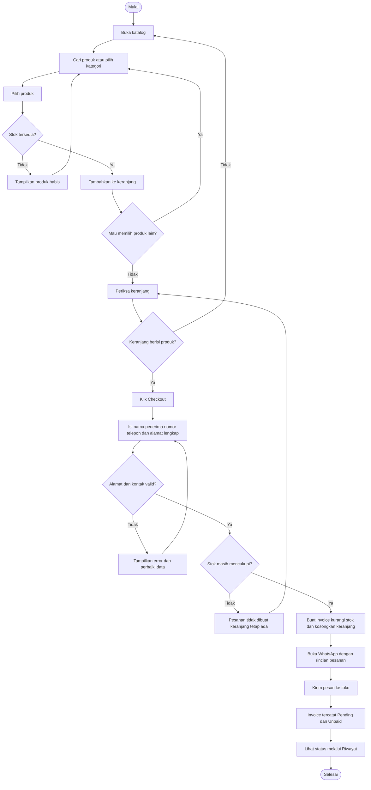
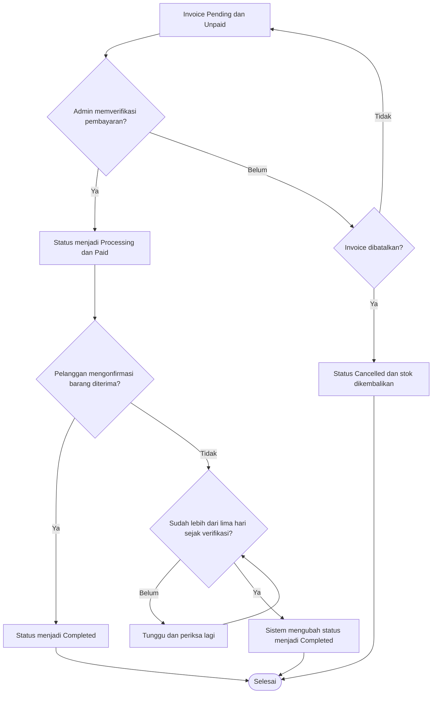
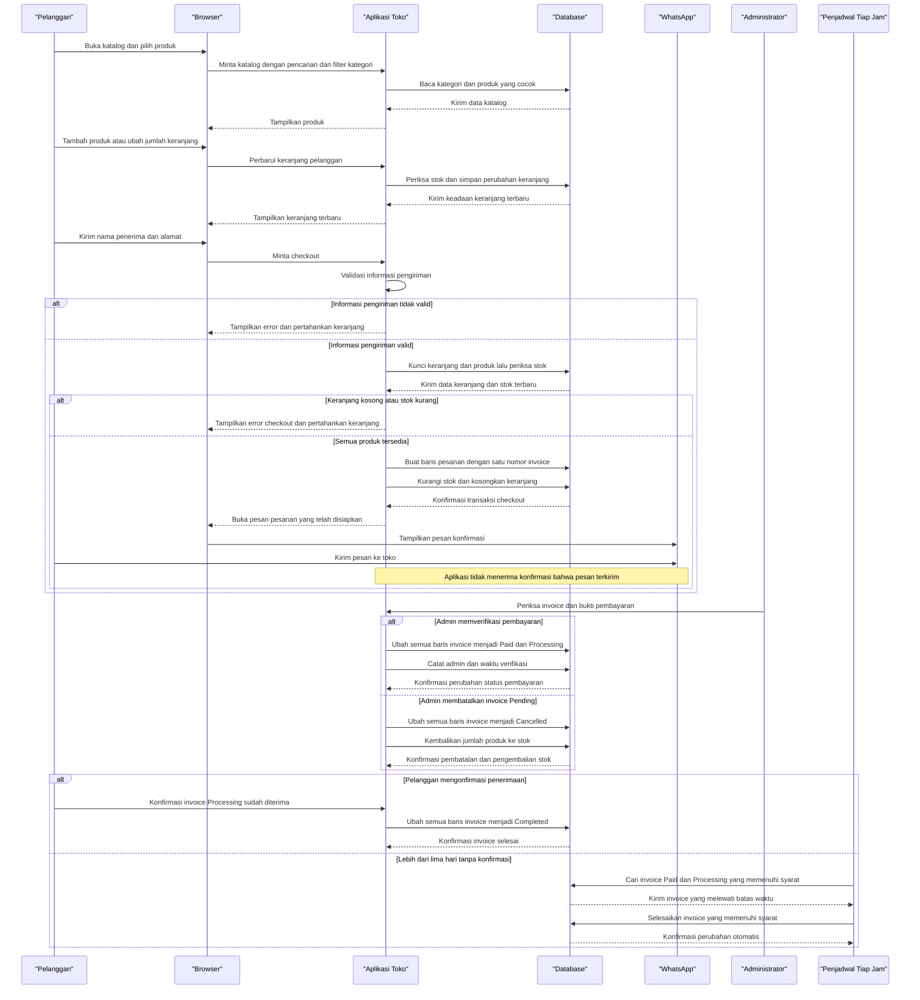

# Core Business Workflows

LИX.goods membantu pelanggan mencari dan membeli produk, sedangkan admin mengelola katalog serta memverifikasi pesanan. Pelanggan menghubungi toko melalui WhatsApp, lalu status pesanan dikelola di aplikasi.

## Domain Entities

| Entity | Service / Bounded Context | Description | Key Relationships |
|---|---|---|---|
| User | Account Management | Akun pelanggan atau administrator. | Pelanggan memiliki keranjang dan pesanan; admin mengelola produk, kategori, dan verifikasi pesanan. |
| ProductCategory | Product Catalog | Mengelompokkan produk agar mudah dicari dan dikelola. | Satu kategori memiliki banyak produk. |
| Product | Product Catalog | Barang yang dapat dijual, memiliki harga, stok, dan kategori. | Berada dalam satu kategori; dapat dimasukkan ke keranjang dan pesanan. |
| Cart | Shopping | Pilihan produk pelanggan sebelum checkout. | Dimiliki satu pelanggan; setiap baris keranjang mewakili produk dan jumlahnya. |
| Order | Ordering and Fulfillment | Satu baris produk yang telah dipesan, termasuk informasi penerima, alamat, pembayaran, dan status. | Terhubung ke pelanggan dan produk; beberapa baris berbagi nomor invoice dari checkout yang sama. |

## Service-to-Domain Mapping

Project ini merupakan satu aplikasi, bukan kumpulan microservice. Konteks di bawah adalah pembagian tanggung jawab secara logis; semuanya berada di aplikasi yang sama dan memakai database bersama.

| Service | Domain Context | Owned Entities | External Dependencies |
|---|---|---|---|
| Aplikasi LИX.goods | Account Management | User | Autentikasi dan session merupakan bagian internal aplikasi. |
| Aplikasi LИX.goods | Product Catalog | ProductCategory, Product | Tidak ada. |
| Aplikasi LИX.goods | Shopping | Cart | Membaca data katalog untuk menampilkan keranjang dan memeriksa stok. |
| Aplikasi LИX.goods | Ordering and Fulfillment | Order | Membaca atau memperbarui stok produk dan data pelanggan saat memproses pesanan. |

## Primary Workflows

### Alur ringkas untuk dijelaskan saat ujian

**Pelanggan:** Buka katalog → cari produk atau pilih kategori → pilih produk → tambahkan ke keranjang → atur jumlah → isi nama, nomor telepon, dan alamat lengkap → checkout → periksa pesan WhatsApp dan kirim ke toko → pantau invoice di Riwayat.

**Jika data alamat atau stok tidak valid:** aplikasi menampilkan error, tidak membuat pesanan, dan keranjang tetap tersedia untuk diperbaiki.

**Admin:** Buka Orders → periksa invoice dan bukti pembayaran → verifikasi menjadi Processing atau batalkan invoice Pending. Setelah barang diterima, pelanggan mengonfirmasi pesanan; jika lupa, sistem menyelesaikan invoice yang memenuhi syarat setelah lebih dari lima hari.

### Workflow 1: Melihat produk dan mengelola keranjang

1. Pelanggan membuka katalog, mencari berdasarkan nama/deskripsi, atau memilih kategori. Pencarian dan filter kategori bisa dipakai bersamaan.
2. Aplikasi menampilkan produk yang cocok dengan pencarian/filter.
3. Pelanggan menambahkan produk yang tersedia. Aplikasi memeriksa stok dan hanya mengubah keranjang milik pelanggan tersebut.
4. Pelanggan dapat menambah/mengurangi jumlah atau menghapus produk. Jumlah tidak boleh melewati stok maupun batas keranjang.
5. Jika keranjang kosong, checkout mengembalikan pelanggan ke halaman keranjang dan tidak membuat pesanan.

### Workflow 2: Checkout dan mengirim konfirmasi pesanan

1. Pelanggan memeriksa produk lalu mengisi nama penerima, nomor telepon, dan alamat lengkap.
2. Checkout memvalidasi data tersebut sebelum mengubah stok atau membuat pesanan.
3. Di dalam transaksi database, aplikasi mengunci keranjang dan produk terkait, lalu memastikan semua produk masih tersedia dan stok mencukupi.
4. Jika data atau stok tidak valid, pesanan tidak dibuat dan keranjang tidak dikosongkan.
5. Jika valid, aplikasi membuat satu baris pesanan untuk tiap produk, memberi semua baris nomor invoice yang sama, mengurangi stok, lalu mengosongkan keranjang.
6. Aplikasi membuka WhatsApp dengan pesan berisi pelanggan, penerima, alamat, invoice, produk, dan total. Pelanggan tetap harus menekan Kirim; aplikasi tidak menerima konfirmasi bahwa pesan telah terkirim.

### Workflow 3: Admin memverifikasi atau membatalkan invoice

1. Admin membuka invoice Pending dan memeriksa bukti pembayaran di luar aplikasi.
2. Jika pembayaran terkonfirmasi, admin menerima invoice. Semua baris menjadi Processing dan Paid serta waktu dan admin verifikator dicatat.
3. Jika invoice masih Pending, admin atau pemilik invoice dapat membatalkannya. Semua baris menjadi Cancelled dan jumlah stok dikembalikan.
4. Invoice yang tidak lagi Pending tidak bisa dibatalkan melalui aksi tersebut. Verifikasi yang sudah berhasil tidak mengubah status untuk kedua kalinya.

### Workflow 4: Konfirmasi barang diterima atau penyelesaian otomatis

1. Untuk invoice Paid dan Processing, pelanggan dapat mengonfirmasi penerimaan dari halaman detail invoice.
2. Aplikasi mengubah semua baris dalam invoice menjadi Completed.
3. Jika pelanggan tidak mengonfirmasi, tugas terjadwal yang berjalan setiap jam menyelesaikan invoice setelah lebih dari lima hari sejak pembayaran diverifikasi, jika semua baris masih Paid dan Processing.
4. Invoice yang sudah berubah status atau tidak memenuhi syarat tidak diubah oleh tugas tersebut.

## User Flowchart

### Alur pelanggan

<!-- mermaid-checked: every participant uses `participant Id as "Label"`, no \n in aliases/messages/notes, every alt/opt/loop closed by end, no `:` inside any alias -->

### Alur verifikasi dan status pesanan

<!-- mermaid-checked: every participant uses `participant Id as "Label"`, no \n in aliases/messages/notes, every alt/opt/loop closed by end, no `:` inside any alias -->

## Cross-Service Data Flows

Tidak ada backend terpisah atau komunikasi API antar-service pada project ini. Browser mengirim request ke aplikasi, lalu aplikasi membaca atau mengubah data katalog, keranjang, dan pesanan pada database bersama.

Setelah checkout, aplikasi membuat URL WhatsApp berisi pesan yang sudah disiapkan lalu mengarahkan browser ke WhatsApp. WhatsApp adalah tujuan eksternal yang digunakan pelanggan, bukan integrasi server-ke-server; aplikasi tidak menerima status pesan terkirim. Tugas otomatis penyelesaian pesanan berjalan di aplikasi yang sama dan memperbarui invoice pada database yang sama.

## Business Workflow Sequence

<!-- mermaid-checked: every participant uses `participant Id as "Label"`, no \n in aliases/messages/notes, every alt/opt/loop closed by end, no `:` inside any alias -->

## Business Rules & Decision Logic

- **Pencarian katalog:** Pencarian memeriksa nama atau deskripsi produk. Filter kategori dapat digabung dengan pencarian.
- **Kepemilikan keranjang:** Keranjang hanya dapat dibaca/diubah oleh pelanggan pemiliknya. Produk harus memiliki stok; jumlah tidak boleh melebihi stok atau batas aplikasi, yaitu 99.
- **Validasi checkout:** Nama penerima wajib dan maksimal 120 karakter; nomor telepon wajib dan maksimal 30 karakter; alamat lengkap wajib dan maksimal 2.000 karakter. Stok diperiksa lagi dalam transaksi sebelum pesanan atau perubahan stok disimpan.
- **Pengelompokan invoice:** Satu checkout membuat satu baris pesanan untuk tiap produk; semua baris menggunakan nomor invoice yang sama.
- **Konsistensi stok:** Checkout yang berhasil mengurangi stok sesuai jumlah pesanan. Pembatalan invoice Pending mengembalikan stok semua baris. Perubahan checkout dan pembatalan dilakukan dalam transaksi.
- **Verifikasi pembayaran:** Invoice baru berstatus Pending dan Unpaid. Admin memverifikasi secara manual; jika berhasil, semua baris menjadi Processing dan Paid, serta admin dan waktu verifikasi dicatat.
- **Penyelesaian pesanan:** Pelanggan hanya dapat mengonfirmasi jika semua baris invoice berstatus Paid dan Processing. Jika tidak ada konfirmasi, tugas tiap jam menyelesaikan invoice yang memenuhi syarat setelah lebih dari lima hari sejak verifikasi pembayaran.
- **Hak akses:** Pelanggan hanya melihat keranjang dan invoice miliknya. Pengelolaan katalog, verifikasi invoice, dan pembatalan oleh admin memerlukan hak admin.
- **Konfirmasi eksternal:** WhatsApp dibuka dengan rincian pesanan, tetapi tindakan mengirim pesan dilakukan pelanggan dan hasilnya tidak dikirim balik ke aplikasi.
